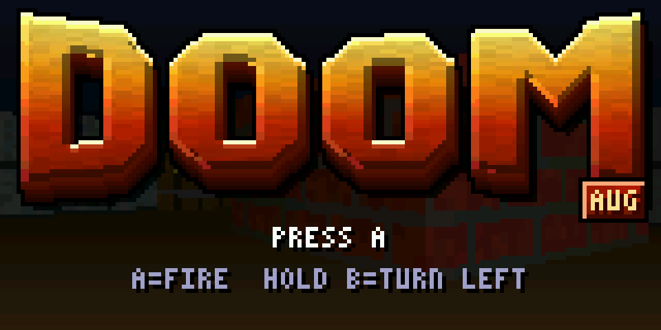
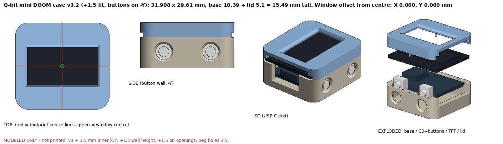
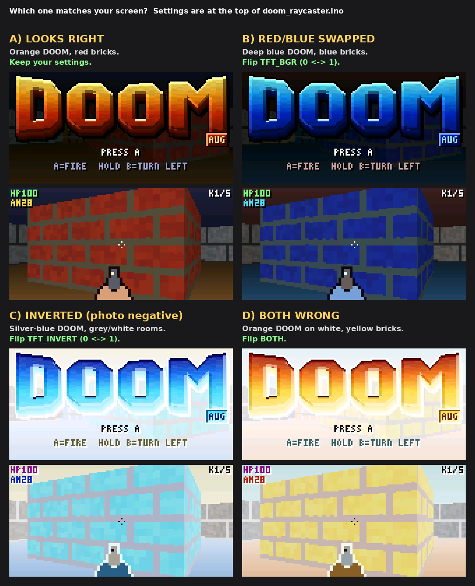

# Q-bit Mini Console

A tiny handheld retro FPS demo for the **ESP32-C3 OLED mini**. It is an original **DOOM-style raycaster** (the same trick *Wolfenstein 3D* used), not the original game. Real DOOM needs around 4 MB of RAM; this chip has about 400 KB, so this is a from-scratch fan-made demo with our own map, monsters, and lettering.

This repo has everything you need to build one: the Arduino firmware, a wiring table, and the v3.2 3D-printable case.





**DOOM** is a trademark of id Software. This project is an unofficial, original fan-made raycaster and is not licensed, sponsored, or endorsed by id Software.

Made by **AUGUSTE.D** on YouTube. Parts and kits: [aug-tec](https://aug-tec.myshopify.com).

---

## What you get

| Folder | What's in it |
|---|---|
| `firmware/doom_raycaster/` | The Arduino sketch. Open `doom_raycaster.ino` and `game_core.h` comes along as a second tab. |
| `case/` | v3.2 base + lid (STL and STEP), a combined print plate (`.3mf`), and a preview image. |
| `images/` | Title-screen and gameplay previews, the case preview, and a color-fix comparison chart. |

The title and gameplay pictures in `images/` are **simulator previews**, not photos of the finished handheld.

---

## Parts list

- **ESP32-C3 OLED mini** — the little board with the 0.42" onboard OLED
- **0.96" 80×160 ST7735S color TFT** — the plug-in screen this firmware is written for
- **2 tactile buttons** — A on IO1, B on IO0, each button's other leg to GND
- **USB-C cable with a slim plug** — the case opening is tight, so a bulky overmold may not seat
- A computer with [Arduino IDE 2.x](https://www.arduino.cc/en/software)

A tilt sensor (MPU-6500) is optional. If one is not wired, or the firmware cannot find it, the game switches to **autopilot**: it walks and aims for you, you shoot with A, and you can still hold B to turn left.

---

## Wiring

Buttons are **active-low** with the chip's internal pull-up: one side of the switch goes to the GPIO, the other side goes to **GND**. The TFT must be powered from **3.3 V, never 5 V**.

| Part pin | ESP32-C3 pin | Notes |
|---|---|---|
| TFT SCL (SPI clock) | **IO8** | The board's blue LED is also on IO8, so it flickers during play. That's normal. |
| TFT SDA (SPI data) | **IO7** | |
| TFT RES | **IO6** | Shared with the onboard OLED's SCL |
| TFT DC | **IO5** | Shared with the onboard OLED's SDA |
| TFT CS | **IO4** | |
| TFT BLK (backlight) | **IO3** | Driven HIGH = backlight on |
| TFT VCC | **3V3** | Never 5 V |
| TFT GND | **GND** | Common ground with the board and buttons |
| Button A | **IO1** → button → **GND** | Fire / start |
| Button B | **IO0** → button → **GND** | Hold to turn left |
| Onboard OLED SDA | IO5 | Built into the board, address `0x3C` |
| Onboard OLED SCL | IO6 | Built into the board |
| MPU SDA (optional) | IO9 | IO9 is also the BOOT button. Don't press BOOT while playing. |
| MPU SCL (optional) | IO10 | |
| MPU VCC / GND (optional) | 3V3 / GND | |

These pins are at the top of `firmware/doom_raycaster/doom_raycaster.ino`.

If the onboard OLED stays dark on a clone board, some boards swap SDA and SCL (IO5 / IO6). Check the silkscreen.

---

## Arduino IDE setup

1. Install [Arduino IDE 2.x](https://www.arduino.cc/en/software).
2. Add ESP32 board support. Go to **File → Preferences → Additional boards manager URLs** and add:

   `https://espressif.github.io/arduino-esp32/package_esp32_index.json`

   Then go to **Tools → Board → Boards Manager**, search **esp32** (by Espressif), and install **3.x**. This project was compiled with **3.3.12**.
3. Install the libraries. Go to **Sketch → Include Library → Manage Libraries** and install:
   - **Adafruit ST7735 and ST7789 Library** (say yes to installing dependencies — that brings in **Adafruit GFX Library** and **Adafruit BusIO**)
   - **U8g2** by oliver
4. Open `firmware/doom_raycaster/doom_raycaster.ino`. `game_core.h` should appear as a second tab automatically.
5. Under **Tools**, set:
   - Board: **ESP32C3 Dev Module**
   - **USB CDC On Boot: Enabled** (so Serial prints over the USB-C cable)
   - Port: your board
6. Click **Upload**, then open the Serial Monitor at **115200** baud.

If the upload will not start, hold **BOOT**, tap **RESET**, then let go of **BOOT**.

---

## TFT color fix

Cheap ST7735S panels do not all agree on color inversion or red/blue order. The kit's known-good settings (already in the sketch) are:

```c
#define TFT_PLUGIN_VARIANT 0
#define TFT_INVERT 1
#define TFT_BGR    0
#define TFT_ROTATION 3
```

Compare your screen to the title picture above (orange/yellow logo, brown/red brick rooms). If yours looks wrong, flip these switches at the top of `doom_raycaster.ino` and upload again:

| What you see | What to flip |
|---|---|
| Logo is **deep blue** and the bricks are blue, but black is still black | Flip `TFT_BGR` (red and blue are swapped) |
| Logo is **pale bluish silver**, rooms look washed-out grey/white, dark parts look light | Flip `TFT_INVERT` (colors are inverted, like a photo negative) |
| Logo is orange but the background is **white** and the bricks are yellow | Flip **both** `TFT_INVERT` and `TFT_BGR` |
| Picture is shifted with a noisy stripe at the edge | Flip `TFT_PLUGIN_VARIANT` between `0` and `1` |
| Picture is upside down | Set `TFT_ROTATION` to `1` or `3` |



The Serial Monitor prints the color-fix settings at boot, for example: `[SCREEN] color fix: INVERT=1 BGR=0`.

Other useful switches in the same file:

- `DISPLAY_MODE`: `0` = auto-detect, `1` = always TFT, `2` = always OLED
- Hold **A** while powering on to force the onboard OLED; hold **B** to force the color TFT
- `TFT_SPI_HZ`: defaults to 8 MHz, which is the safe starting point. You can try `27000000` or `40000000` for more frames per second once the picture looks right

---

## Controls

| Input | Action |
|---|---|
| **A** | Shoot (hold for auto-fire). Also starts the game and restarts after you win or die. |
| **Hold B** | Turn left. This works even during autopilot — let go and autopilot steers again. |
| Doors | Open by themselves when you walk up to them. No button needed. |
| **Hold A + B** for 1 second | Recalibrate the tilt sensor (only if an MPU is connected) |
| Tilt (optional MPU) | Tilt left/right to turn, forward/back to walk |
| No MPU | Autopilot walks and aims. You still shoot with A and can hold B to turn left. |

The goal is to take out all 5 monsters. You get 30 bullets.

---

## Print the case (v3.2)


The printable files are in `case/`:

- `qbit_mini_console_case_v3_2_base.stl` / `.step` — the base
- `qbit_mini_console_case_v3_2_lid.stl` / `.step` — the lid
- `qbit_mini_console_case_v3_2_PLATE.3mf` — both parts on one plate, already oriented
- `preview_v3_2.png` — a modeled preview (not a photo of a print)

**Status:** v3 was printed and was about 1.5 mm too tight and too short, with the button holes on the wrong long wall and snap holes that came out too small. **v3.2** takes those notes and adds 1.5 mm of inside room, 1.5 mm of wall height, moves the buttons to the other long wall, and opens the snap holes to 1.5 mm. **This latest revision has not been print-verified yet.**

Suggested settings (Bambu A1, 0.4 mm nozzle):

- Filament: **Bambu PLA Basic** (or any decent PLA)
- Process: **0.16 mm High Quality**. Use **0.12 mm Fine** if you want a crisper window and pegs
- **Supports off**, 15% infill, no brim
- **Base:** floor-down
- **Lid:** flipped top-down (the window sits on the bed)
- The `.3mf` plate already has both parts oriented this way

The lid pegs are tiny (1 mm) and the holes are 1.5 mm. If a peg will not go in, open the hole with a 1.2 mm bit or snip the peg off. If a peg is fragile, that is normal at this size.

Assembled size is about **31.9 × 29.6 × 15.5 mm**.

---

## Assembly

1. Print the base and lid and clean off any fuzz around the button holes, USB opening, and lid window.
2. Drop the ESP32-C3 into the base with the **USB-C port facing the USB opening**.
3. Seat the two buttons in the holes on the long wall. Wire **A to IO1** and **B to IO0**, other legs to **GND**.
4. Wire the TFT to the numbered-row pins in the table above (3.3 V only). Set the screen in the lid pocket so the window lines up with the panel.
5. Use a **slim USB-C cable**. A fat overmold may not fit the opening.
6. Snap the lid onto the base. The three pegs drop into the holes in the lid.
7. Plug in, upload the sketch, and you should get the title screen. Open Serial at 115200 if you need to see what the board detected.

---

## Troubleshooting

| Problem | What to try |
|---|---|
| Upload will not start | Hold BOOT, tap RESET, then release BOOT. Confirm the port and that **USB CDC On Boot** is Enabled. |
| Blank screen | Confirm TFT VCC is on **3V3**, not 5 V. Hold **B** while plugging in to force the TFT, or set `DISPLAY_MODE` to `1`. Check CS / DC / RES wires. |
| Colors look inverted or swapped | Use the color-fix table above and `images/tft_color_fix.png`. |
| Picture is shifted or has a junk stripe | Flip `TFT_PLUGIN_VARIANT`. |
| Picture is upside down | Set `TFT_ROTATION` to `1` or `3`. |
| Buttons do nothing | Each button must go to **GND**, not 3V3. A is IO1, B is IO0. |
| Blue LED flickers while the game runs | Normal. The LED shares IO8 with the TFT clock. |
| Game walks by itself | That's autopilot, which turns on when no tilt sensor is found. Hold B to turn left, A to shoot. |
| Case feels tight or the lid will not snap | This is v3.2, sized up after the v3 print. If it is still tight, lightly sand the inner walls. If the pegs are tight, open the holes a little. |
| Screen sags in the lid | The pocket is sized for a 24 mm-wide panel that rests on the two short end walls. If your panel is narrower, a thin shim helps. |

---

## License

Code, case files, and docs are released under the [MIT License](LICENSE).

**DOOM** is a trademark of id Software. The title lettering in this demo is our own procedural design, not the official id Software logo or mark. This project is not affiliated with id Software.
